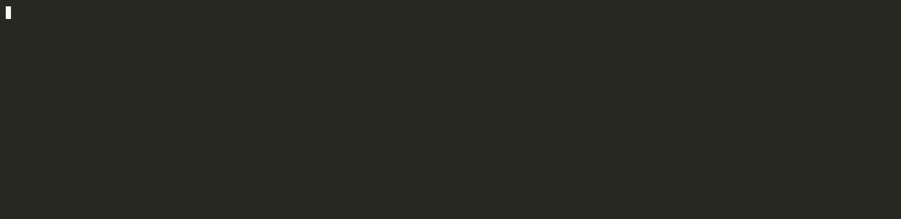

<p align="center">
  <a href="https://nextbrew.dev">
    <picture>
      <source media="(prefers-color-scheme: dark)" srcset="site/public/brand/mark-dark.svg">
      
    </picture>
  </a>
</p>

<h1 align="center">nextbrew</h1>

<p align="center">Homebrew, but fast. A Homebrew-compatible package manager written in Rust.</p>

<p align="center"><a href="https://nextbrew.dev">Website</a> · <a href="https://nextbrew.dev/en/docs">Docs</a> · <a href="https://nextbrew.dev/ja">日本語</a></p>

<p align="center"></p>

It installs Homebrew's official bottles and casks without needing Ruby or
Homebrew itself, and runs alongside an existing Homebrew.

## Speed

Installing 22 popular formulae on a GitHub Actions macOS runner
([benchmarks](https://nextbrew.dev/en/benchmarks), 2026-10-25):

| | nextbrew 0.1.2 | Homebrew 7.0.10 |
| --- | --- | --- |
| Cold (nothing cached) | 20.5 s | 260.6 s |
| Warm (downloads cached) | 2.8 s | 226.1 s |

## Homebrew-compatible

- The same bottles, casks, taps and Brewfiles; command names, options and exit
  codes follow `brew`.
- `nb migrate` moves an existing Homebrew installation over: formulae, casks,
  taps, pins and services.
- Casks (app, pkg, dmg, zip and more), services (launchd and systemd),
  `nb bundle`, and building from source.
- macOS and Linux, tested on Debian, Fedora, Arch and openSUSE.

See [compatibility](https://nextbrew.dev/en/docs/reference/compatibility) for
the details.

## Install

```bash
curl -fsSL https://nextbrew.dev/install | bash
```

The installer adds a `# >>> nextbrew >>>` block to your shell config
(`~/.zshenv` or `~/.zshrc`, `~/.bash_profile` or `~/.bashrc`). Restart your
terminal or run the `source` command it prints. To keep your config untouched,
pass `--no-modify-path`:

```bash
curl -fsSL https://nextbrew.dev/install | bash -s -- --no-modify-path
```

> Status: early development. Expect breaking changes before 1.0.

## Quick start

```bash
nb migrate                      # move over from Homebrew
nb install jq                   # install a formula
nb install cask:ghostty         # install a cask (app, DMG, zip)
nb bundle                       # install from a Brewfile
nb uninstall jq
nb outdated
nb upgrade
nbx jq --version                # run without linking
```

## Build from source

```bash
cargo build --release
./target/release/nb --version
```

## Sponsoring

If nextbrew saves you time, you can support its development through
[GitHub Sponsors](https://github.com/sponsors/zorro901).

## Credits

nextbrew started as a fork of [zerobrew](https://github.com/zerobrewhq/zerobrew)
and keeps its license. It is not affiliated with Homebrew. Parts derived from Homebrew are
under the BSD 2-Clause license in [LICENSE-HOMEBREW](./LICENSE-HOMEBREW).

## License

MIT ([LICENSE-MIT.md](./LICENSE-MIT.md)) or Apache 2.0
([LICENSE-APACHE.md](./LICENSE-APACHE.md)), at your option.
